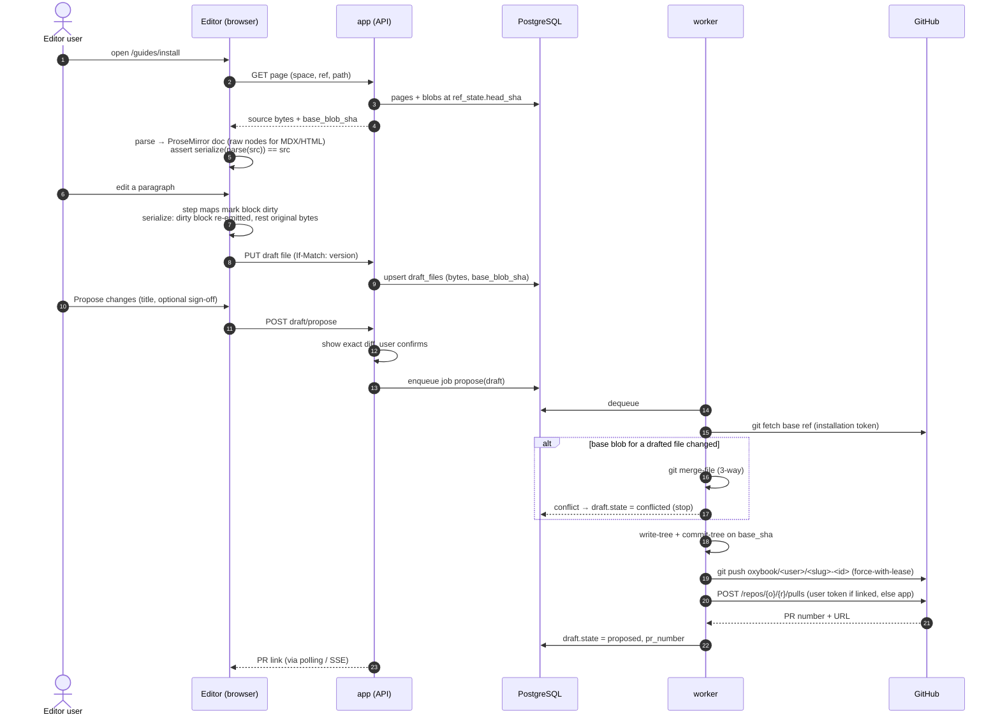
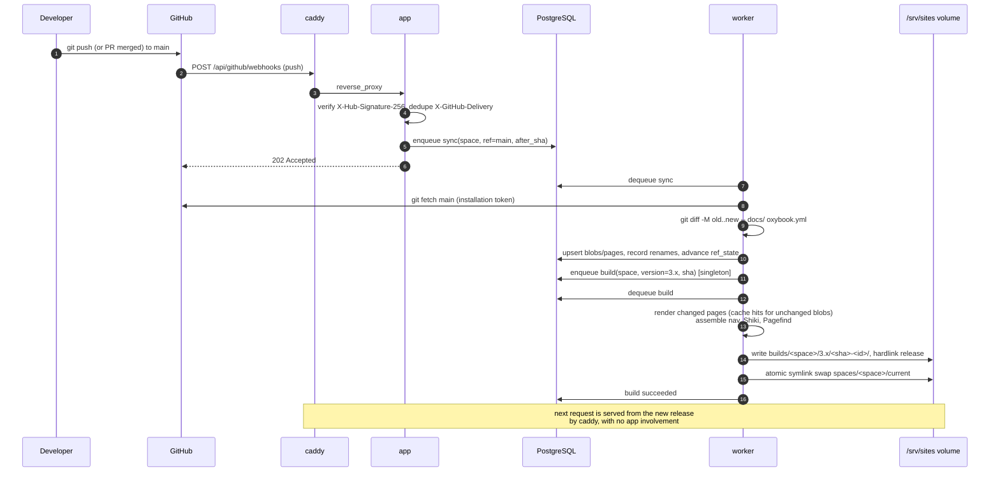

# OxyBook architecture

Status: design document, pre-implementation.

This document describes the v1 system. Where a decision has an obvious alternative, the alternative and the reason for rejecting it are stated. Anything marked *planned* is outside v1 (see [MVP.md](MVP.md)).

## 0. Invariants

These are the properties every other decision is measured against. A change that violates one of them is a bug, not a trade-off.

1. **The customer's git repository is the source of truth.** OxyBook never holds page content that the repo does not, except unproposed drafts (section 4.4). Every OxyBook cache can be deleted and rebuilt from git.
2. **Lossless round-trip.** Opening a file in the editor and saving it with no edits produces the identical bytes. Editing one block changes only the bytes of that block. Constructs the editor does not understand are preserved byte-for-byte and are never silently dropped or rewritten.
3. **OxyBook never writes to a base branch.** All writes go to `oxybook/*` branches and reach the base branch only through a pull request merged under the repository's own rules.
4. **Published sites do not depend on the app being up.** A built site is static files served by the edge proxy.
5. **Content is not executed.** v1 never evaluates JavaScript found in repository content (MDX `import`/`export`, `{expressions}`), on the server or at build time.

## 1. System overview

```
                 ┌────────────── GitHub ──────────────┐
                 │  customer repo   ·  GitHub App      │
                 └───────▲──────────────────┬──────────┘
         git fetch/push, │                  │ webhooks (push, pull_request,
         REST (PRs)      │                  │ installation*)
                         │                  ▼
┌─────────┐  HTTPS  ┌────┴─────┐  jobs   ┌──────────┐
│ browser │────────►│  caddy   │────────►│   app    │──── PostgreSQL
│ (editor │         │  (edge)  │         │ (API +   │      (state, cache,
│ /reader)│◄────────│          │         │  editor) │       job queue)
└─────────┘ static  └────▲─────┘         └──────────┘          ▲
            sites        │ reads                               │
                         │ /srv/sites                          │
                    ┌────┴─────────────────────────────────────┴┐
                    │ worker: git mirrors, sync, build, search    │
                    │ index; writes /srv/sites (shared volume)    │
                    └─────────────────────────────────────────────┘
```

Three processes from one codebase and one container image (`app`, `worker`, plus `caddy` as an off-the-shelf edge), one PostgreSQL. No Redis, no Elasticsearch, no object store in the default topology.

## 2. Content model

### 2.1 Spaces

A **space** is one published documentation site. It is bound to exactly one GitHub repository, a **content root** (a directory inside the repo, default `docs/`), and a **default ref** (usually `main`). Several spaces may point at the same repository with different content roots, which is how monorepos with multiple doc sets are supported.

### 2.2 Repository conventions

```
repo/
├── oxybook.yml                # space config (optional; defaults apply)
└── docs/                      # content root
    ├── index.md               # page "/"
    ├── _dir.yml               # optional: title and order for this directory
    ├── getting-started.md     # page "/getting-started"
    ├── guides/
    │   ├── index.mdx          # page "/guides"
    │   ├── _dir.yml
    │   ├── install.md         # page "/guides/install"
    │   └── images/
    │       └── install-1.png  # asset, served at /guides/images/install-1.png
    └── _partials/             # leading "_" : never a page
```

Rules, in order of precedence:

- **Pages** are `*.md` and `*.mdx` files under the content root. `.md` is parsed as CommonMark + GFM + frontmatter + container directives; `.mdx` is parsed as MDX 3. A `.md` file is never parsed as MDX: `<` and `{` mean different things in the two formats, and guessing would corrupt files.
- **Directory pages:** `index.md` / `index.mdx` is the page for its directory. `README.md` is accepted when no `index.*` exists, so a repo that is browsable on GitHub stays browsable.
- **Ignored:** any file or directory whose name starts with `_` or `.` (except `_dir.yml`), and anything listed under `exclude:` in `oxybook.yml`.
- **Assets:** every other file under the content root is served at its relative path. Editor uploads go to an `images/` directory next to the page (configurable), and are referenced with relative paths so the markdown renders correctly on GitHub too.

### 2.3 Page tree and ordering

The file tree *is* the page tree. There is no separate navigation database.

Ordering is per directory, in an optional `_dir.yml`:

```yaml
title: Guides            # label for the directory in the sidebar
order:                   # file or directory names, without extension
  - install
  - configuration
  - troubleshooting
# anything not listed follows, sorted by title
```

Rejected alternatives: numeric filename prefixes (`01-install.md`) make reordering a rename, which changes URLs and blows up diffs; a per-page `sidebar_position` frontmatter key makes moving one page touch every sibling, which creates conflict-prone PRs. A single small file per directory keeps a reorder to a one-file, few-line diff. Drag-and-drop in the editor's sidebar edits `_dir.yml` and nothing else.

### 2.4 Frontmatter

YAML frontmatter delimited by `---`. Keys OxyBook understands:

| key           | meaning                                              |
|---------------|------------------------------------------------------|
| `title`       | page title; fallback: first H1, then filename        |
| `description` | meta description, search snippet                     |
| `slug`        | URL override (relative to the directory, or absolute if it starts with `/`) |
| `nav_title`   | shorter label for the sidebar                        |
| `hidden`      | built and reachable by URL, omitted from the sidebar |

Every other key is preserved untouched. Frontmatter is parsed with the [`yaml`](https://eemeli.org/yaml/) package's `Document` API, which keeps comments, key order, quoting style and anchors; editing `title` in the editor's metadata panel changes only that scalar's bytes. Unknown keys are displayed read-only in the metadata panel. If the frontmatter fails to parse as YAML, the entire frontmatter block becomes a raw, read-only region (see 3.3) and the known-key form is disabled for that page.

### 2.5 URLs, slugs, and renames

- URL = path relative to the content root, extension removed, `index` collapsed: `guides/install.md` → `/guides/install`. Case is preserved; nothing is lowercased or prefix-stripped automatically, because silent normalisation is how URLs break.
- Versions other than the default are prefixed: `/2.x/guides/install` (2.6).
- **Internal links are authored as relative file paths** (`[Install](../guides/install.md)`), never as site URLs. The renderer rewrites them to URLs; the editor's link picker inserts file paths. This keeps links valid on GitHub, makes them checkable at build time, and makes renames mechanical.

Renames *inside* OxyBook produce, in the same commit:

1. the `git mv`,
2. a redirect entry appended to `redirects:` in `oxybook.yml` (old URL → new URL),
3. byte-range patches to every inbound relative link in the space: only the link destination span is rewritten; the rest of the referring file is untouched.

Renames *outside* OxyBook (someone runs `git mv` and pushes) are detected on sync with git rename detection (`git diff -M` between the previously built commit and the new head). The build serves an **inferred redirect** immediately, and the space admin sees a one-click prompt to open a PR that commits the redirect to `oxybook.yml`. OxyBook does not inject stable page IDs into frontmatter: writing machine IDs into every customer file is an unrequested change to their repo.

### 2.6 Versions

Versions are git refs, not copied folders.

```yaml
# oxybook.yml (read from the default ref only)
versions:
  - name: "3.x"
    ref: main
    default: true          # served at /
  - name: "2.x"
    ref: release/2.x       # served at /2.x/
  - name: "1.0"
    ref: v1.0.0            # a tag: published, read-only in the editor
```

Each version is built from its own ref, with that ref's content and `_dir.yml` files, so documentation for an old release lives on the release branch next to the code it describes. Editing an older version opens a PR against that branch. Tags are published but cannot be edited (you cannot open a PR into a tag). The `versions:` list is read from the default ref only, so one file controls the switcher. Rejected: Docusaurus-style `versioned_docs/` snapshots duplicate content inside one branch, and fixes then have to be applied N times by hand; git already has a primitive for "the docs as of release X".

## 3. Editor

### 3.1 Framework decision: TipTap on ProseMirror

| | ProseMirror + TipTap | Lexical | Plate (Slate) |
|---|---|---|---|
| Document schema | Strict, declarative; invalid documents are unrepresentable | Node classes, less declarative | Slate is schemaless; validity via normalisers |
| Change tracking | Steps + position maps: we can compute exactly which top-level blocks a transaction touched | Dirty-node tracking exists, keyed by node | Operations exist; mapping to source ranges is DIY |
| Opaque/atomic nodes with custom views | `atom` nodes + NodeViews, long-standing | Decorator nodes | Void elements |
| API stability | ProseMirror is mature and stable; TipTap 3.x core is MIT | Pre-1.0 (0.53 at time of writing) | Slate's README states it is in beta; Plate ships frequent major versions |
| Licence | MIT (we use no TipTap Pro extensions or TipTap Cloud) | MIT | MIT |

**Decision: TipTap 3 for extension/React ergonomics, dropping to raw ProseMirror APIs (`prosemirror-model`, `prosemirror-transform`, NodeViews, plugins) wherever round-trip correctness is involved.** The deciding factors are the strict schema (the serializer must handle every node type exhaustively, and the schema makes "every node type" a closed set) and step maps (they tell us precisely which source regions are dirty, which is the core of the round-trip design). Lexical is a credible editor but its markdown story is transformer-based import/export, which is the normalising approach we must avoid, and it has no 1.0. Slate's beta status and normaliser-based validity make exhaustive, lossless serialization harder to guarantee.

TipTap's own markdown extension is **not** used for import/export: it is a convenience converter and does not preserve source bytes. Markdown parsing and serialization are ours (`packages/doc-model`), built on unified/remark.

### 3.2 Supported (editable) constructs in v1

Paragraphs, ATX and setext headings, emphasis/strong/strikethrough/inline code, links (inline and reference-style), images, bullet/ordered/task lists, blockquotes, fenced and indented code blocks, thematic breaks, GFM tables, hard breaks, callouts written as container directives (`:::note … :::`, the syntax shared by Docusaurus, VitePress and Starlight) and GitHub alerts (`> [!NOTE]`).

### 3.3 Raw-preservation nodes

Everything else becomes one of two ProseMirror node types:

- `raw_block` (block, `atom: true`, `selectable: true`, not editable): attrs `{ source: string, kind }` where `kind` is one of `mdx-jsx`, `mdx-esm`, `mdx-expression`, `html`, `html-comment`, `directive`, `definition`, `unparsed`.
- `raw_inline` (inline, `atom: true`): same, for inline JSX (`<Badge>new</Badge>`), inline HTML, inline expressions.

The NodeView renders the exact source, syntax-highlighted, with a label ("MDX component `<Tabs>` — edit in source"). Users can move or delete a raw block as a whole, as an explicit action, with the deletion visible in the diff preview. They cannot change its contents in the visual editor. Developers can switch any page to **source mode** (CodeMirror 6 on the raw file), which is also the fallback for files that cannot be parsed at all.

v1 treats JSX components as opaque even when their children are markdown (`<Tab>` containing a list). Structured, editable containers for allowlisted components are planned.

### 3.4 Lossless round-trip

Parsing (`packages/doc-model`):

1. Detect and record file-level facts: BOM, line ending (LF/CRLF), trailing-newline presence.
2. Split off frontmatter (2.4).
3. Parse the body with `remark-parse` + `remark-gfm` + `remark-directive` (for `.md`) or `remark-mdx` (for `.mdx`). mdast nodes carry `position.start.offset` / `position.end.offset`.
4. Walk top-level mdast children. For each, slice the **original source** `src[start:end]`, and record the **gap** (the bytes between the previous node's end and this node's start: blank lines, trailing whitespace).
5. Convert each top-level node to a ProseMirror node. Every top-level PM node carries attrs `{ srcId }` pointing at a side table `{ srcId → { source, gapBefore } }`. Unsupported mdast nodes become `raw_block` / `raw_inline` with `source` set to their exact slice.
6. Infer a **style profile** from the file: bullet marker, emphasis and strong markers, fence character and length, ordered-list delimiter, list indentation, table pipe padding. Used only for blocks that must be re-serialized.

Editing: a ProseMirror plugin inspects every transaction's step maps and marks the top-level blocks whose ranges were touched as **dirty**. Block identity survives moves because `srcId` travels with the node; a moved but otherwise unedited block keeps its original bytes.

Serializing:

```
out = bom + frontmatter_bytes
for block in doc.topLevel:
    if block.srcId and not dirty(block):
        out += gapBefore(block) + source(block)        # original bytes
    else:
        out += (gapBefore(block) or "\n\n") + serialize(block, styleProfile)
out += trailing; normalise line endings back to the detected style
```

`serialize` is an exhaustive switch over the schema; `raw_block` / `raw_inline` always emit their `source` attribute verbatim, including when nested inside a dirty block. Link marks keep `referenceType`/`identifier` so reference-style links are re-emitted as references; hard breaks keep their form (two spaces vs backslash); headings keep ATX vs setext.

What may change: the bytes **inside a block the user edited** may be normalised (for example table column padding after editing a cell). What may never change: any byte outside edited blocks, and any byte of a raw node.

Granularity in v1 is the top-level block: editing one item of a 40-item list re-serializes that list. Recursive preservation for list items and blockquotes is planned and uses the same mechanism one level down.

Enforcement:

- **Load-time identity check.** Every time a file is opened, `serialize(parse(src)) === src` is asserted. If it fails, the file opens in source mode only, with a visible notice, and the failure is logged with the file hash. Correctness is never traded for convenience.
- **Diff preview.** Before a PR is opened, the user sees the exact unified diff that will be committed.
- **Corpus test (CI).** A pinned set of public documentation repositories (Docusaurus, Starlight, VitePress and MkDocs sites, plus our own fixtures) is fetched at CI time by commit SHA; every file must pass the identity check or be classified as source-only. Regressions fail the build.
- **Property test (CI).** Random single-block edits on corpus files must produce diffs whose changed line range lies within the edited block's original range.

## 4. Sync layer

### 4.1 GitHub App

One GitHub App per OxyBook instance. Self-hosters create theirs with GitHub's App Manifest flow from the setup screen, so they never hand-type permissions.

- Repository permissions: **Contents: read & write**, **Pull requests: read & write**, **Metadata: read**. Nothing else; in particular not **Workflows**, so OxyBook cannot modify `.github/workflows/*` even if a path check were bypassed.
- Webhook events on the manifest: `push` and `pull_request`. GitHub delivers `installation` and `installation_repositories` itself when the App has a webhook. Putting those two names in `default_events` makes GitHub reject the manifest.
- Server-to-server: a JWT signed with the app's private key is exchanged for **installation access tokens** (short-lived; cached in memory until shortly before expiry, never persisted).
- User-to-server: users may link their GitHub account. When linked and the user has write access, PRs are opened with their user token, so the PR author is the human. Otherwise the PR is opened by the app, and commits carry the user's name with a configurable commit email (default: a per-instance noreply address, so OxyBook does not publish user emails into git history).
- **DCO-enforcing repos:** a space setting adds a `Signed-off-by:` trailer, but only after the committing user ticks an explicit affirmation in the propose dialog, because a sign-off is a statement the human makes, not the bot.
- Connecting a repository to a space requires the OxyBook admin to have a linked GitHub account with admin or write access to that repo (checked with their user token), so instance-wide app installation does not let any OxyBook admin attach any repo.

### 4.2 Read path: mirror plus content-addressed cache

The worker keeps a **blobless partial clone** (`git clone --bare --filter=blob:none`) per repository under `/var/lib/oxybook/mirrors`, authenticated with an installation token over HTTPS. Blobs are fetched on demand, and only under content roots. The mirror is a cache: deleting it costs one re-fetch.

PostgreSQL holds the materialised read model:

- `blobs(sha PK, bytes)`: content-addressed by git blob SHA, deduplicated across refs and versions.
- `ref_state(space_id, ref, head_sha, synced_at)`.
- `pages(space_id, ref, path, blob_sha, title, url, nav_title, hidden, tsv, …)`.

The editor reads exclusively from this model. No GitHub API calls happen on page view.

Sync job `sync(space, ref, to_sha)`:

1. `git fetch` the ref into the mirror.
2. `git diff --name-status -M <from_sha> <to_sha> -- <content_root> oxybook.yml`.
3. Upsert changed blobs and pages; delete removed ones; record renames for inferred redirects.
4. Advance `ref_state` in the same transaction.
5. If `ref` backs a published version, enqueue `build`.

Triggers: the `push` webhook (signature verified with `X-Hub-Signature-256`, deduplicated by `X-GitHub-Delivery`); a periodic reconciliation that compares `git ls-remote` heads with `ref_state` (webhook delivery is not guaranteed); and opening a page in the editor, which does a cheap head check if the last sync is older than a short threshold.

Rejected: the Contents REST API as the read path. It is per-file, burns rate limit on large trees, and gives us no local merge tooling. Also rejected: a full clone. Docs often live in large monorepos; blobless clones bound the cost to the content root.

### 4.3 Write path: branch → commit → PR

Writes use the same mirror and plain `git` (≥ 2.38 for `merge-tree --write-tree`; Debian bookworm ships 2.39):

1. Build the new tree from `base_sha` plus the draft's file operations (via a temporary index, `git update-index` / `git write-tree`). No working tree is checked out.
2. `git commit-tree` with the user as author.
3. `git push` to `refs/heads/oxybook/<user>/<slug>-<draft-id>`, using `--force-with-lease=<ref>:<expected-sha>` on updates so a concurrent push on GitHub is never clobbered.
4. Open the PR via REST (or update it). Body: summary, list of pages changed, link back to the draft.

Guards enforced by the worker, not the UI: target ref must match `oxybook/*`; every touched path must be inside the space's content root or be `oxybook.yml`; file size limits apply.

Open question for the M1 spike: repositories with rulesets that require signed commits on `oxybook/*` branches will reject pushed, unsigned commits. The fallback is to create commits through the Git Database REST API for those spaces. This is to be verified, not assumed.

### 4.4 Drafts

A draft is per (user, space, base ref). `drafts(id, space_id, user_id, base_ref, base_sha, branch, pr_number, state, version)` and `draft_files(draft_id, path, op, old_path, base_blob_sha, bytes)`. The editor autosaves into the draft with optimistic concurrency (`version`, `If-Match`), so two tabs cannot silently overwrite each other. Nothing reaches git until the user clicks **Propose changes**; after that, each further save in the same draft becomes a new commit on the PR branch.

Drafts are the one place OxyBook holds content that is not in git, which is why PostgreSQL must be backed up.

### 4.5 Conflicts when the base moved

Each draft file records `base_blob_sha`. When the base ref advances (push webhook) or the PR branch changes on GitHub (`pull_request` `synchronize`):

1. **Untouched files changed upstream:** no action; the draft's files are re-based by rebuilding the tree on the new head.
2. **A drafted file changed upstream:** three-way merge of (`base_blob`, `upstream_blob`, `draft_bytes`) with `git merge-file`.
   - Clean merge: the draft is updated, and the user sees "updated with changes from main".
   - Conflict: the editor shows a **block-level conflict view**. Both sides are parsed with the same model; conflicting regions map to top-level blocks (markdown paragraphs are usually single lines, so line-level conflicts align with blocks naturally); the user chooses *mine / theirs / edit* per block. Raw blocks can only be resolved by picking a side or by source mode.
3. **PR branch:** if every commit on the branch was written by OxyBook, the branch is rewritten on the new base and pushed with `--force-with-lease`. If anyone else has pushed to it, OxyBook never rewrites history; it adds a merge commit produced by `git merge-tree --write-tree` instead.
4. An "open on GitHub to resolve" escape hatch is always offered.

Concurrent OxyBook users on the same page each get their own draft. There is no locking. The editor shows "Alex has an open draft that touches this page", sourced from `draft_files`. Real-time co-editing is a non-goal for v1.

### 4.6 Sequence: user edits a page → PR is opened



## 5. Publish pipeline

### 5.1 Decision: static build, not on-demand SSR

Each (space, version, commit) is rendered once into an immutable directory of HTML, assets and a search index, and served as files by Caddy.

- Docs are read far more often than written, and a version's content at a commit never changes, so rendering per request repeats identical work.
- Static output keeps invariant 4: readers are unaffected if `app` or `worker` is down or mid-upgrade.
- Rendering MDX-ish content per request would put the most complex code path on the hot path, and cache invalidation across nav-tree changes is harder than rebuilding.
- The output is portable. Exporting to any static host is a tarball (planned as a feature; possible by construction).

Cost accepted: a nav change touches every page's sidebar, so a full site re-assembly happens on each build. This is mitigated by caching rendered page bodies keyed by `(blob_sha, renderer_version, theme_version, link-target-set hash)` and assembling sidebar and template around them, which is cheap.

### 5.2 Renderer

`packages/renderer` does **not** compile MDX to JavaScript (doing so and running the result would execute repository code, violating invariant 5). Instead:

1. Parse with the same `doc-model` parser as the editor (one parser, one set of bugs).
2. mdast → hast with `mdast-util-to-hast`, with custom handlers:
   - relative `.md`/`.mdx` links → site URLs; unresolved links → build warnings (`strict: true` makes them errors);
   - container directives / GitHub alerts → callout component;
   - `mdxJsxFlowElement` / `mdxJsxTextElement`: if the name is in the component allowlist **and** every attribute is a static literal (strings, numbers, booleans, or JSON-literal expressions that parse without evaluation), render the theme's React component with those props and recursively rendered children; otherwise render a visible placeholder and emit a build warning;
   - `mdxjsEsm`, `mdxFlowExpression`, `mdxTextExpression`: not evaluated; `{/* comments */}` are dropped; others become placeholders with a warning.
3. Syntax highlighting with Shiki at build time (no client-side highlighter).
4. `react-dom/server` renders the theme layout to static HTML. Interactive components (tabs, the version switcher, search UI) hydrate as small client-side islands shipped by the theme.

**Import mapping.** Existing MDX often imports components (`import Tabs from '@theme/Tabs'`). `oxybook.yml` can map import specifiers to built-in components (`components: { "@theme/Tabs": Tabs, "@theme/TabItem": TabItem }`), so common Docusaurus/Starlight content renders without executing the import. The editor still shows these as raw blocks in v1.

### 5.3 Build job

```
build(space, version, sha):
  read tree at sha from mirror (git cat-file --batch, no checkout)
  load oxybook.yml, _dir.yml files → nav tree
  for each page: render body (cache by blob_sha+versions) → template with nav
  copy assets (hardlink where possible)
  pagefind --site <out>                       # search index for this version
  write /srv/sites/builds/<space>/<version>/<sha>-<build_id>/
  assemble release dir: hardlink tree (cp -al) of default version at root,
                        other versions under /<name>/
  atomic swap: rename(symlink tmp → /srv/sites/spaces/<space>/current)
  ensure /srv/sites/by-host/<hostname> → ../spaces/<space> for each domain
  record build status + log; prune old builds (keep last N)
```

Builds per (space, version) are serialised; a newer commit supersedes queued builds for the same version (pg-boss singleton keys). Hardlinked release trees mean assembling a multi-version site copies no file data.

### 5.4 Sequence: repo push → site rebuilds



### 5.5 Theming and custom domains

- **Theme:** v1 ships one default theme (`packages/theme-default`, Apache-2.0) configured from `oxybook.yml`: logo, favicon, accent colours, fonts, header links, footer, plus an optional custom CSS file in the repo. Custom theme *code* through the SDK is planned.
- **Custom domains:** Caddy's on-demand TLS obtains certificates when a TLS handshake arrives for a hostname that the app approves through Caddy's `ask` endpoint (`GET /internal/domains/check?domain=…`, which returns 200 only for verified domains). Verification requires the customer to point a CNAME at the instance and pass a DNS TXT challenge shown in the UI. Production Caddyfile sketch:

```caddyfile
{
	on_demand_tls {
		ask http://app:3000/internal/domains/check
	}
}
https:// {
	tls {
		on_demand
	}
	handle /_oxybook/* {
		reverse_proxy app:3000
	}
	handle {
		root * /srv/sites/by-host/{host}/current
		try_files {path} {path}.html {path}/index.html
		file_server
	}
}
```

Because the worker maintains `by-host/<hostname>` symlinks, Caddy needs no per-domain configuration and no reload when domains are added.

## 6. Search

**v1: Pagefind for published sites, PostgreSQL full-text search inside the app.**

- Published sites: Pagefind indexes the built HTML at the end of each build and ships a chunked static index plus a small client. No search server, works for private sites under the same auth as the pages, and keeps invariant 4. One index per version, so results never mix versions.
- Editor/app: `pages.tsv` (`tsvector`, title weighted A, headings B, body C, GIN index) for "find page" and the link picker, scoped by space and ref.

**When to graduate** to a dedicated engine (Meilisearch is the intended choice: single binary, typo tolerance, simple to self-host): when one of these is needed, not before: search across spaces or versions in one query; typo tolerance and relevance tuning that Pagefind cannot provide; or site sizes where Pagefind's client-side index fetching measurably degrades result latency for readers. The renderer emits a search-document stream (`url, title, headings, text, version`) from day one, so adding an indexer is a new consumer, not a rewrite.

## 7. Authentication and authorisation

**Authentication (v1):** email + password (argon2id) with email verification and invites; "Sign in with GitHub" via the GitHub App's user authorisation. Sessions are server-side rows in PostgreSQL behind an `HttpOnly`, `SameSite=Lax` cookie. SAML/OIDC SSO and SCIM are v1 non-goals; when they ship they ship in the AGPL codebase.

**Authorisation:** roles are per space; an organisation has Owners (manage members, instance settings and the GitHub App) and Members.

| Role | Can |
|---|---|
| **Admin** | connect repo, configure versions, domains, theme, visibility; manage space members; everything below |
| **Editor** | create drafts, upload images, propose and update PRs, rename/move pages, reorder nav |
| **Viewer** | read the editor in read-only mode; read a private published site |

**Merging is not a OxyBook permission.** Review and merge happen on GitHub under the repository's branch protection and CODEOWNERS. A OxyBook Editor without a GitHub account can propose but never land a change. That is the safety model that makes it acceptable to give non-developers edit access.

**Private sites:** Caddy `forward_auth` to `app` (`/internal/auth/site`) on spaces marked private. Unauthenticated readers are redirected to the app's login; on success the app redirects to `https://<site-host>/_oxybook/auth/callback?code=…`, which exchanges a one-time code for a host-only session cookie on the site's domain. This works the same on platform subdomains and custom domains.

Page-level permissions are a non-goal: the unit of access is the space, which matches how the repo itself is permissioned.

## 8. Multi-tenancy and self-host topology

**Data model:** every row carries `org_id`. A self-hosted instance normally has one organisation; the schema does not assume it. A hosted multi-tenant service (not v1) adds PostgreSQL row-level security on `org_id` as defence in depth, plus per-tenant build quotas. Because v1 builds never execute repository code (invariant 5), running builds in the shared worker process is acceptable; running full MDX later requires a sandboxed build runner (separate container, no network, no credentials), which is the precondition for that feature.

**`docker compose up` must include:**

| service | image | role |
|---|---|---|
| `postgres` | `postgres:17` | state, read-model cache, drafts, job queue (pg-boss), app FTS |
| `app` | OxyBook image | API, editor SPA, auth, webhooks, Caddy `ask`/`forward_auth` endpoints |
| `worker` | same OxyBook image, `worker` command | git mirrors, sync, propose/merge jobs, builds, Pagefind |
| `caddy` | `caddy:2` | TLS (incl. on-demand), static site serving, reverse proxy to `app` |

**Optional:** an SMTP server (any provider; Mailpit in the dev compose file) for invites and password reset. Without SMTP, admins create accounts and copy invite links by hand. S3-compatible storage for build output is planned for multi-node deployments; v1 uses a shared volume.

**Volumes:** `pgdata` (back this up: drafts and accounts live here), `mirrors` (cache, disposable), `sites` (rebuildable from git, shared read-only into Caddy), `caddy_data` (certificates; keep to avoid ACME rate limits).

Horizontal scale in v1 is "more worker replicas": jobs are claimed through pg-boss (`SKIP LOCKED`), mirrors are per-worker caches, and builds write to the shared `sites` volume. `app` is stateless.

## 9. Technology choices

| Area | Choice | Why |
|---|---|---|
| Language | TypeScript on Node.js 24 LTS | one language across editor, parser, renderer and server; the parser runs identically in browser and worker |
| Repo layout | pnpm workspaces monorepo | strict dependency isolation, fast installs, no extra build orchestrator needed at this size |
| API server | Fastify 5 | schema-validated routes, low overhead, plain Node; no full-stack framework needed because the editor is an SPA and sites are static |
| Editor UI | React + Vite SPA | the editor is an authenticated single-page app; SSR adds nothing there |
| Editor core | TipTap 3 on ProseMirror | strict schema and step maps make lossless round-trip tractable (3.1) |
| Source mode | CodeMirror 6 | standard, extensible code editor; doubles as the raw-block viewer |
| Markdown/MDX | unified, remark-parse, remark-gfm, remark-directive, remark-mdx (MDX 3) | positional mdast with exact offsets; the same parser for editor and renderer |
| Frontmatter | `yaml` (Document API) | comment- and style-preserving edits |
| Rendering | mdast-util-to-hast + React server rendering, own handlers | renders allowlisted components without executing repository code |
| Highlighting | Shiki | build-time highlighting, VS Code grammars, zero client JS |
| Database | PostgreSQL 17 | one stateful dependency for state, cache, queue and FTS |
| Query layer | Kysely + plain SQL migrations | typed SQL without an ORM's runtime model |
| Jobs | pg-boss | durable queue on the database we already run; singleton keys for build debouncing |
| Git | `git` CLI ≥ 2.38 in the worker | partial clones, rename detection, `merge-file`, `merge-tree --write-tree`; no reimplementation of git |
| GitHub API | Octokit (`@octokit/app`) | official SDK for app JWTs, installation tokens and webhooks |
| Search | Pagefind (sites), PostgreSQL FTS (app) | no search server in v1; clear graduation path to Meilisearch (6) |
| Edge | Caddy 2 | automatic and on-demand TLS, static serving, `forward_auth`, single binary |
| Email | Nodemailer over SMTP | provider-agnostic |

## 10. Repository layout (code)

```
apps/server           AGPL-3.0   Fastify API, auth, webhooks
apps/worker           AGPL-3.0   sync, propose, build jobs
apps/editor           AGPL-3.0   React/TipTap editor SPA
packages/doc-model    AGPL-3.0   parser, raw-preservation, serializer, style profile
packages/renderer     AGPL-3.0   mdast → static HTML, build orchestration
packages/sdk          Apache-2.0 config schema (oxybook.yml, _dir.yml), component and theme interfaces
packages/theme-default Apache-2.0 layout, CSS, client islands shipped to readers
packages/components   Apache-2.0 built-in MDX components (Callout, Tabs, Card, …)
deploy/               Apache-2.0 compose files, Caddyfiles
```

See [../LICENSING.md](../LICENSING.md) for why the split falls where it does.
